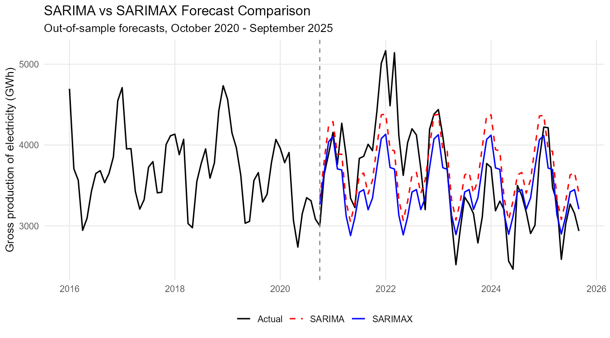

# Forecasting Electricity Production in Bulgaria with SARIMA and SARIMAX

Can a seasonal ARIMA model forecast Bulgaria's monthly electricity production five years ahead, and does a dummy for the period from 2020 onwards improve it?
This project models gross electricity production (January 2001 – September 2025) with SARIMA and SARIMAX models and compares their forecasts on a 60-month out-of-sample test period.

Course project, Mathematical Foundations of Machine Learning and AI – MSc Applied Mathematics (Mathematical Modelling in Economics), Sofia University.

---

## Key results

**Selected model:** SARIMA(1,0,0)(1,0,1)[12] on log production, chosen by BIC from three candidates. The SARIMAX version adds a dummy for the period from 2020 onwards (COVID and after).

| Coefficient (SARIMAX) | Estimate | p-value |
|---|---|---|
| AR(1) | 0.680 | < 0.001 |
| Seasonal AR(1) | 0.993 | < 0.001 |
| Seasonal MA(1) | −0.824 | < 0.001 |
| Intercept | 8.210 | < 0.001 |
| Dummy (2020 onwards) | −0.073 | 0.097 |

- Strong persistence both month-to-month and year-to-year; the seasonal pattern (winter peaks, spring/summer troughs) is very stable.
- Production from 2020 onwards is about **7% lower**, significant at the 10% level.
- The Ljung–Box test shows no residual autocorrelation.

**Out-of-sample forecasts (test period October 2020 – September 2025, 60 months)**

| Model | RMSE (GWh) | MAE (GWh) | MAPE | ACF1 | Theil's U |
|---|---|---|---|---|---|
| SARIMA | **495.8** | 426.4 | 12.2% | 0.777 | 1.059 |
| SARIMAX | 507.2 | **403.5** | **10.9%** | 0.774 | **0.978** |

- Both models capture the seasonal pattern well.
- SARIMA has the lower RMSE, while SARIMAX has the lower MAE, MAPE and Theil's U, so neither model dominates on all measures.
- Forecast errors remain autocorrelated (ACF1 ≈ 0.78): over a five-year horizon that includes the 2022 energy crisis and the drop in production in 2023–2024, the models follow the seasonal pattern but miss the persistent level changes.



---

## Methodology

1. **Data** – monthly gross electricity production in Bulgaria, GWh, January 2001 – September 2025 (297 observations).
2. **Stationarity** – ADF test (stationary in levels) and HEGY test for seasonal unit roots on the training sample: seasonal unit roots are rejected at all seasonal frequencies, so no seasonal differencing is needed.
3. **Train/test split** – the last 20% (60 months) is held out as the test sample.
4. **Identification** – ACF/PACF of log production; three SARIMA candidates compared by BIC.
5. **Diagnostics** – residual checks with the Ljung–Box test.
6. **SARIMAX** – the selected model with a dummy for the period from 2020 onwards.
7. **Evaluation** – RMSE, MAE, MAPE, ACF1 and Theil's U on the test sample, SARIMA vs SARIMAX.
8. **Final model** – SARIMAX re-estimated on the full sample.

---

## Limitations

- A single 60-month test window: results depend on this particular period, which includes the 2022 energy crisis.
- The dummy is a simple level shift and is equal to 1 throughout the test period, so it shifts the forecast level but does not model the shocks themselves.
- The seasonal AR coefficient is very close to 1 (0.993), so seasonality is almost deterministic.
- No explanatory variables such as temperature, prices or electricity exports are included.

---

## Repository structure

```
├── README.md
├── data/
│   └── Project.csv                       # monthly gross electricity production, GWh
├── code/
│   └── SARIMAX_Electricity_Bulgaria.R
└── output/
    └── figures/
        └── forecast_test_sample.png
```

## How to run

1. Clone or download the repository and set the working directory to the repository folder.
2. Install the packages:

```r
install.packages(c("lubridate", "tidyverse", "tseries", "uroot", "urca", "zoo", "forecast", "scales"))
```

3. Run `code/SARIMAX_Electricity_Bulgaria.R`.

## Data

Monthly gross production of electricity in Bulgaria, GWh. Source: `[fill in: e.g. NSI or Eurostat]`.

## Author

Dimitar Zhelezov · [LinkedIn](https://www.linkedin.com/in/dimitarzhelezov) · [GitHub](https://github.com/dimiturzhelezov)
